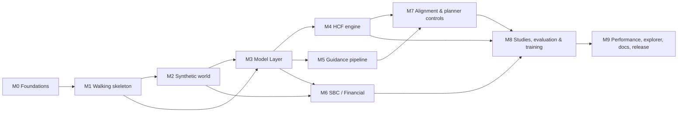

# Implementation plan

**Status:** Final, v1.0. Each **milestone** becomes a GitHub milestone and each **epic** a parent issue. Tasks become sub-issues one milestone ahead of the work (section 10).

## 1. What we're building

One repository with three components that share one contract surface.

| Component | What it does |
|---|---|
| **Headcount forecast (HCF)** | An employee-level, monthly Monte Carlo simulation. Every active employee and every open requisition is a row in a preallocated array. Each month runs a fixed sequence of domains, such as attrition, promotion, backfill, fills, cancellation, and growth. Each domain scores eligible rows with a model and returns a declarative change. One function applies every change. |
| **Guidance forecast** | An offline pipeline of aggregate time series. It forecasts event counts per group and month, reconciles them to a stock-flow identity, and can align them to plan targets. The simulation consumes these counts as exact quotas through quota sampling. |
| **SBC expense** | A financial layer. It sizes equity grants, lays out their vest schedules, and tracks tranches by holder. After the simulation it amortizes every tranche under ASC 718, with attrition, rate-change, and vesting true-ups. The vesting true-up is the residual, so a per-tranche accounting identity holds by construction. |

Everything runs on a **seeded synthetic world** that the repository generates. No real data, no credentials, and no external systems are involved.

### 1.1 Goals

- Implement the full method end to end: synthetic data, guidance forecast, simulation, SBC expense, and the study and evaluation harness.
- Keep the core design properties:
  - Three layers with a one-way dependency.
  - A single writer for simulation state.
  - A frozen configuration.
  - One encoding authority.
  - Exact-count quota sampling.
  - Three separate valves for requisitions and events.
  - An accounting identity that holds by construction.
  - A run-mode ladder that releases one pinned input per rung.
  - Provenance on every input.
- Use the synthetic world's known ground truth. Every model and study can report how well it recovers the true parameters, a test that real data can't offer.
- Every run is reproducible from a configuration and a seed.

### 1.2 Non-goals

- Cloud infrastructure, for now. Every part of the system runs locally on a developer machine: world generation, training, guidance fits, simulations, studies, and the explorer. GitHub Actions serves only as CI for lint and tests. Cloud infrastructure is deferred and may come later (section 9).
- Any real organization's names, systems, transaction codes, org structure, compensation policy, parameters, or measured figures (section 2).
- A live data warehouse. DuckDB stands in for one, so the SQL extraction layer is real and testable.
- A comparison against an earlier production engine. A naive *independent-sampling* engine serves as the reference baseline, so a study can show what quota sampling buys.
- Backward compatibility. This is a new codebase, so it carries no retired-key aliases, format upgraders, or rename windows.

## 2. Clean-room and sanitization policy

The repository is public. The following rules apply to code, docs, issues, PRs, and commit messages alike.

1. **No real-world specifics.** No company, product, or internal system names. No internal codes, org or cost-center identifiers, or names of people or teams.
2. **No measured figures.** Every default parameter is invented, round, and documented as synthetic in `docs/synthetic-defaults.md`. No default is copied from a real measurement, even when it's re-derived.
3. **Generic vocabulary.** We use the public glossary (`docs/glossary.md`). Domain concepts carry generic names, such as `org_level{n}`, `cost_center`, `TERM`, `XFER_IN`, `regular` and `contingent` accounts, and rating tiers `R1`–`R5`.
4. **The private reference stays private.** The private reference specification never enters this repository or its history. A pre-push hook enforces this (M0.3).
5. **Automated scanning.** A denylist scanner runs on every commit, push, PR, and issue. Its patterns live outside the repository: in a local file and in an Actions secret. The scanner never prints a matched string, only the location and a pattern index.
6. **Human review.** Every PR template carries a sanitization checkbox.

## 3. Architecture

### 3.1 Package layout

The repository holds one installable package, `hcsim`, with layer boundaries enforced by `import-linter` contracts in CI. The synthetic-data package is `hcsim.synth`.

```
src/hcsim/
├── model/        Model Layer, the leaf. It imports nothing else in hcsim.
│   ├── interface.py   model protocols
│   ├── core/          schema and vocabularies, buffer layouts, transaction codes and
│   │                  measures, guidance categories, the fill tree, the group aligner,
│   │                  the GuidanceForecast artifact, the AlignmentTarget, provenance
│   ├── ml/            entity, rate, generative, Markov, and similarity models;
│   │                  samplers; metrics; the arm matrix; persistence
│   ├── domains/       domain model classes (employee/, requisition/)
│   ├── data/          populations, subsets, quota derivations, share bases
│   └── sql/           column catalog, template renderer, population compiler, templates
├── guidance/     Guidance pipeline. Imports hcsim.model only.
├── financial/    Financial Layer. Imports hcsim.model.core only, and runs without a simulation.
├── engine/       Orchestration: config, planner rules, state, apply step, step loop, handlers.
│                 Imports model and financial.
├── studies/      Run modes, profiles, inputs, harness, backends, evaluators, gates,
│                 scorecard, CLI. Imports everything except synth.
├── synth/        Synthetic world generator. Imports nothing from hcsim, so the world
│                 can't share code, and therefore assumptions, with the models fitted to it.
└── bench/        Scale harness and capacity model.
apps/explorer/    Interactive demo (M9).
tools/            Sanitization scanner, plan-to-issues script, dev utilities.
docs/             Design, ADRs, data contract, domain pages, glossary.
```

### 3.2 Dependency rules

The following `import-linter` contracts enforce the layer direction.

- `hcsim.model` doesn't import `guidance`, `financial`, `engine`, `studies`, or `synth`.
- `hcsim.financial` imports only `hcsim.model.core` and `hcsim.model.interface`.
- `hcsim.guidance` doesn't import `engine`, `financial`, or `studies`.
- `hcsim.synth` imports nothing from `hcsim`.
- No study module imports another study module, and `studies.inputs` imports nothing from `studies.catalog`.

### 3.3 The synthetic world and the data contract

`hcsim.synth` simulates a company with its own *ground-truth* processes. It then emits the raw, label-valued **source tables** that a real HR-finance warehouse would hold, written to a DuckDB file and optionally to Parquet. The data contract in `docs/data-contract.md` versions these tables.

| Table | Grain | Purpose |
|---|---|---|
| `workforce_txn` | Employee × transaction × reporting date | Seeding, labels, replay, realized flows |
| `workforce_agg` | Pre-summed by org dimensions × transaction × month | Guidance pipeline input |
| `req_interval`, with the `req_snapshot` view | Requisition × state interval. The view materializes snapshots with gaps. | Opening seed, fill and cancellation training, requisition series |
| `pending_start` | Accepted offer × snapshot date | Known future hires |
| `dim_job`, `dim_org`, `dim_location`, `dim_company`, `dim_account` | One row per member | Encoding, grouping, populations |
| `plan_headcount` | Vintage × cost center × month × fan-out dimensions | Plan targets |
| `equity_award`, `equity_vest`, `equity_valuation`, `equity_holder`, `equity_expense` | Award, tranche, or period | SBC seeding and SBC actuals |
| `stock_price` | Month-end close, plus a daily grant-date fair value | Sizing and valuation |
| `comp_range` | Job family × level × location | Award sizing |
| `rating` | Employee × calibration cycle | Performance |
| `truth/` (manifest) | Parameters | The true hazards, latent plans, and policies, used only by tests and recovery reports |

The world's processes deliberately differ in functional form from the engine's models. It uses daily event times, nonlinear tenure effects, random effects per cost center, regime shocks, and a latent growth plan. Fitted models therefore have to *learn* the world rather than mirror it.

### 3.4 Technology stack (proposed)

| Concern | Proposal | Alternatives |
|---|---|---|
| Python and environment | Python 3.12–3.14 with `uv`. CI tests 3.12 and 3.14. | Poetry |
| Simulation arrays | **NumPy**: float64 buffers on the CPU, with random draws from `numpy.random.Generator` streams spawned by `SeedSequence`. Performance-critical kernels live in one `ops` module, so another backend could be added later. | PyTorch |
| Frames | **pandas** 2.x (statsforecast requires pandas below 3.0), with DuckDB doing the heavy relational work in SQL | Polars |
| Warehouse stand-in | DuckDB | SQLite |
| Classifiers | scikit-learn `HistGradientBoostingClassifier` | LightGBM |
| Execution | Local only. No cloud services, schedulers, or remote compute. | Deferred (section 9) |
| Time series | `statsforecast`, `darts` (core install, with PyTorch only in the `darts-deep` extra), and `sktime`, each wrapped behind the `TimeSeriesModel` protocol. Prophet is an optional extra. | — |
| Tuning | Optuna (TPE) | — |
| QP solver | `cvxpy` with Clarabel or OSQP | SciPy |
| Configuration | Frozen dataclasses with collect-all validation for `SimulationConfig`, and Pydantic v2 for YAML study profiles | Pydantic for both |
| Quality | `ruff` (line length 100), `mypy` (strict on `model` and `financial`, with the Pydantic plugin), `pytest`, `hypothesis`, `import-linter`, `pre-commit` | `pyright`, for editor use only |
| Docs | MkDocs Material, built locally | Sphinx |

## 4. Milestones

The plan builds a **walking skeleton first**: a thin path through every layer (M1). It then deepens each area. After M1, four tracks can run in parallel.



| Milestone | Outcome | Acceptance |
|---|---|---|
| M0 Foundations | Repo, tooling, CI, sanitization guardrails, design baseline | CI is green. A planted denylist token fails locally and in CI without being echoed. A planted layer violation fails `import-linter`. |
| M1 Walking skeleton | `synth tiny` → guidance → HCF → SBC → study, e2e in CI | A 12-month, 20-trajectory run realizes quotas exactly. The H and O identities are exact, and the per-tranche identity holds within 0.01. The same seed gives bit-identical results. E2E CI finishes in under 3 minutes. |
| M2 Synthetic world | Every source table, quirk, the equity ledger, and the ground-truth manifest | Coherence validators pass on every preset. Every quirk has a toggle and a test. Generation takes under 60 s for `small` and under 10 min for `medium`. |
| M3 Model Layer | The full contract surface, every model family, training drivers, and the arm matrix | Protocol conformance passes. Trained arms beat their null arm on held-out synthetic data. Recovery reports compare fits with the truth manifest. |
| M4 HCF engine | Every domain, known events, fills over the fill tree, transfers, and replay | Replay reproduces the synthetic month-end headcount per cost center. `guided_actuals` honors every quota. Unguided counts land within the `stat_check` bound of expectation. Streaming runs are bit-identical to standard runs. |
| M5 Guidance pipeline | Ingestion through formatting, reconciliation, alignment solvers, and disaggregation | Artifacts are coherent within tolerance. The QP solver passes its known-answer cases. A ladder study runs. |
| M6 SBC | Sizing, vesting, timing, the tracker, prices, the seed and offline streams, and the Phase 3 calculator | The hand-computed examples pass. Every tranche satisfies the identity within 0.01. Chunked results equal unchunked ones bit for bit. An SBC replay study scores against the synthetic ledger. |
| M7 Alignment and planner controls | Five alignment methods, supply rules, credit and floor, rate calibration, shares, tilts, and caps | Every alignment known-answer case passes. Share targets land within 0.01 where attainable. Tilts land within the `stat_check` bound over 2,000 trajectories. |
| M8 Studies and evaluation | Profiles, inputs, the harness, backends, nine evaluators, gates, the scorecard, the CLI, and the study catalog | Every catalog study runs from the CLI with the documented exit codes. Every scorecard row carries provenance. |
| M9 Performance, explorer, docs | Benchmarks at 500k synthetic employees, a local explorer app, a docs site, and a release | A benchmark baseline is stored and a 20% regression is flagged. The docs site builds locally. A tagged release ships. |

## 5. Epics and tasks

Each epic below becomes a parent issue, and each bullet becomes a sub-issue. IDs (`M1.3`) prefix the issue titles.

### M0 — Foundations and guardrails

**M0.1 Repository bootstrap**
- Add NOTICE, README, CONTRIBUTING (conventional commits, the contribution policy, and sanitization rules), and SECURITY. The first commit already holds this plan, the issue script, and the Apache-2.0 LICENSE.
- Set up `uv` with the `src/hcsim` layout and empty subpackages. NumPy, pandas, and DuckDB are core dependencies. Extras cover `darts`, `darts-deep` (darts with PyTorch, for its deep models), `sktime`, `prophet`, `app`, and `docs`.
- Add a `stat_check` test helper with a per-check false-failure rate of 1e-4, about 3.9 standard errors. A suite of 100 statistical checks then fails by chance less than 1% of the time.
- Configure `ruff`, `mypy` (strict on `model` and `financial`, with the Pydantic plugin), `pytest`, `hypothesis` profiles, and `pytest-xdist`.
- Add `pre-commit`, and add `.gitignore` entries for generated output (`data/`, `outputs/`, `artifacts/`, `reports/`, `.cache/`).

**M0.2 CI and project hygiene**
CI only checks code. Nothing is deployed or executed remotely. Every CI step calls a `make` target, so local and CI runs can't diverge.

- Add `make check` for the fast jobs and `make check-all` for the fast and heavy jobs.
- Add `ci.yml`, which runs on every PR to `main` and every push to `main`.
  - Fast jobs: `ruff`, `mypy`, `import-linter`, unit and property tests on Python 3.12 and 3.14, the sanitization scan, `gitleaks`, and a conventional-commit check on PR titles.
  - Heavy jobs on the same PRs, each added in the milestone that introduces it: slow and acceptance tests, the e2e skeleton and its determinism check (M1.9), `small`-world generation (M2.10), and the time-series adapter tests (M5.4). Heavy jobs skip draft PRs.
  - Test selection from the import graph. `tools/affected.py` uses the `grimp` graph that `import-linter` builds to map changed files to the tests they can affect. A change in `financial` runs the financial, engine, and studies tests, and a change in `model` runs everything.
  - A `ci-pass` job waits for every other job and fails if any of them failed. It's the only required check, so renaming a job or a Python version never breaks branch protection, and skipped jobs need no special handling.
  - Every job has a timeout. Generated test worlds are cached under a key built from the generator's source hash, the preset, and the seed. Hypothesis' example database is cached between runs, and a failing property test uploads its reproduction blob.
- Add `post-merge.yml`, which runs the suite on macOS on every push to `main`. A newer merge cancels an older run still in progress.
  - A failure opens one tracking issue, or comments on the one already open. The next success closes it.
- Add quality gates:
  - Diff coverage: at least 90% of changed lines covered, and 95% in `hcsim.financial`, checked by `diff-cover` inside the job.
  - Peak memory: `pytest-memray` limits on the e2e skeleton and the benchmark fixtures. Timing is recorded but never gated, because shared runners are noisy.
  - Metric baselines, from M1.9: the skeleton run and one reference study write a small scorecard. CI compares it with the committed baseline and fails on an unexplained change. An intentional change updates the baseline in the same PR.
- Add supply-chain and workflow checks: `actionlint` and `zizmor` on the workflows, `uv lock --check`, `pip-audit`, and a license check that flags dependencies incompatible with Apache-2.0.
- Configure Dependabot for weekly, grouped updates to GitHub Actions and `uv` dependencies. Dependabot PRs can't read Actions secrets, so the denylist is stored as a Dependabot secret too. An update that shifts random streams shows up in the metric baselines.
- Harden CI: read-only default permissions, third-party actions pinned to commit SHAs, and no `pull_request_target`. Protect `main` with `ci-pass`, and squash-merge.
- Add issue templates (epic, task, bug, question), a PR template with a sanitization checklist, labels, and milestones.
- Contribution policy: issues are welcome and PRs are not accepted. CONTRIBUTING says so, and `close-outside-prs.yml` closes PRs from non-collaborators with a pointer to it. That workflow is the one `pull_request_target` exception: it never checks out PR code.

**M0.3 Sanitization guardrails**
- Write `tools/sanitize_scan.py`. It reads patterns from a path or an environment variable, scans tracked files, staged diffs, and commit messages, and reports only the location and pattern index.
- Add `pre-commit`, `commit-msg`, and `pre-push` hooks. The pre-push hook also refuses any history that contains the private reference file.
- Add a CI job that reads the `SANITIZE_DENYLIST` secret. A missing secret fails the job. Outside PRs are closed automatically (M0.2), so no PR runs without the secret.
- Scan the whole tree on every push to `main`, in addition to each PR's changes.
- Scan every file before CI uploads it as an artifact, because anyone signed in to GitHub can download artifacts from a public repo.
- Add an `nbstripout` hook so notebooks are committed without outputs, and scan notebook JSON.
- Add a workflow that scans issue and PR titles and bodies on open and edit, plus branch names, tags, and release notes.
- Turn off the repo's wiki and Discussions, which nothing scans.
- Add `gitleaks` for credential patterns.
- Write `docs/sanitization.md`, the public policy. The list itself stays private.

**M0.4 Design baseline**
- Write `docs/design/overview.md`: the three components, the three layers, the invariants, and the three valves.
- Write `docs/design/notation.md` (stocks, rates, flows, quotas, the two identities, metrics) and `docs/glossary.md`.
- Write the ADRs:
  - 0001: layered architecture.
  - 0002: quota sampling for aggregate alignment.
  - 0003: pure handlers with a single writer.
  - 0004: three valves.
  - 0005: amortization after the simulation.
  - 0006: known events as a capability, not a mode.
  - 0007: one frozen configuration.
  - 0008: the synthetic world as the sole data source.
  - 0009: NumPy as the array backend, with performance-critical kernels isolated in one `ops` module.
  - 0010: time-series libraries behind one adapter protocol.
  - 0011: local-only execution, with cloud deferred.
  - 0012: pandas for frames, with DuckDB for heavy relational work.
- Add `import-linter` contracts on the empty packages.

### M1 — Walking skeleton (thin e2e path)

Every M1 epic is a deliberately minimal version of a later epic. Each one notes where it continues.

**M1.1 Synthetic world, lite** (continues in M2)
- Generate a tiny world: about 200 employees, 10 leaf cost centers, a 2-level org, 4 job families, 5 levels, 1 location, and 1 company.
- Build a monthly workforce process covering hires, terminations, and transfer legs, with month-end `ACTIVE` stocks, over 60 months of history.
- Build a requisition process with growth and backfill, one opening each, and external and transfer fills. Emit it as `req_interval` with a `req_snapshot` view.
- Add flat compensation ranges, a GBM stock price, new-hire awards with vests, and a simple reference ledger.
- Add a `hcsim synth generate --preset tiny --seed N` command that writes DuckDB.

**M1.2 Model core, lite** (continues in M3)
- Write `SimulationSchema`: sorted vocabularies, zero-based codes, `-1` as unattributed, and encode and decode.
- Declare the employee and opening buffer layouts.
- Add the `attrition`, `hires`, `requisitions_opened`, and `headcount` categories.
- Write a single-column group aligner.
- Write the `GuidanceForecast` artifact: long-form save and load, `get_quota`, coverage, and a fingerprint.
- Write the protocols `EntityModel`, `GroupRateModel`, `TimeSeriesModel`, and `SamplingStrategy`.

**M1.3 Sampling, lite** (continues in M3.9)
- Write a Bernoulli sampler, largest-remainder apportionment, and segmented Gumbel-top-k quota sampling that realizes exactly `min(K, eligible)` per group.
- Add property tests for exact counts and for zero selection in group `-1`.

**M1.4 Models, lite** (continues in M3.10)
- Write a constant entity model and a naive stratified-rate model.
- Write a pooled backfill rate, a Poisson growth count, and an empirical attribute generator.

**M1.5 Guidance, lite** (continues in M5)
- Ingest from DuckDB, composing measures into categories, and aggregate by cost center.
- Fit two benchmark models (seasonal naive and historical average) with rolling-origin evaluation and top-k inverse-error selection.
- Reconcile greedily with the headcount anchor fixed, and format the result into an artifact.

**M1.6 Engine, lite** (continues in M4)
- Write a frozen `SimulationConfig` with direct construction only, plus `SimulationState` and a seed manager (a hash of seed, subsystem, and trajectory).
- Seed the employee and opening buffers from DuckDB.
- Write `DomainResult` and the apply step (drop, write, and append for both buffers, then grants), and raise an error on overflow.
- Build the step loop with the attrition, backfill, external fill (unguided and single-quota), cancellation, and growth domains. Growth uses the guidance residual or the historical rate.

**M1.7 Financial, lite** (continues in M6)
- Write a new-hire gap-fill strategy, one vest template, and an RSU tracker (a per-employee vest buffer plus a holder ledger with forfeiture).
- Add `StaticPrice` and `AnnualGrowthPrice`.
- Write a Phase 3 calculator: gross, net at a flat rate, the attrition true-up, and the vesting true-up as the plug, plus an identity check and the SBC output frame.

**M1.8 Study harness, lite** (continues in M8)
- Write a minimal profile (scope, mode, seed, trajectories), a one-arm harness, and an `invariants` evaluator covering the quota, the H and O identities, and the accounting identity.
- Add a scorecard CSV and a `hcsim study run` command.

**M1.9 E2E in CI**
- Run tiny world generation → guidance fit → study run → invariant assertions, plus a determinism check (two runs with the same seed are bit-identical).
- Add a performance smoke test that records the wall-clock time of the tiny run.

### M2 — Synthetic world (full)

**M2.1 World configuration and reference structures**
- Add the presets `tiny`, `small` (5k), `medium` (50k), and `large` (500k), with every parameter in `WorldConfig`.
- Generate an org hierarchy of N levels with uneven depth, padding deep levels with the leaf, plus `cost_type` and `field_type`.
- Generate a job catalog (families, an ordered level vocabulary, a tech indicator, titles with a manager marker), locations with a region tree, companies with a planning rollup and offline subsidiaries, and `regular`, `contingent`, and `temporary` accounts.

**M2.2 Ground-truth workforce process**
- Attrition: nonlinear in tenure and level, dependent on rating, seasonal, with random effects per cost center and regime shocks.
- Promotion: configurable cycle months, a readiness process, and an optional family change.
- In-place family reclassification, reorganization batches, conversions in and out, and a contingent pool.
- Termination programs (RIF events) over multi-month windows.
- Event dates sampled within the month.

**M2.3 Requisition and hiring process**
- Growth: a latent plan per cost center, negative-binomial noise, and seasonality.
- Backfill: a probability per departure, a share that opens in another cost center, and an anticipatory channel.
- Campus: a seasonal schedule at entry levels.
- An openings distribution that includes bulk placeholder requisitions.
- Channel hazards (external, transfer, conversion, campus) that depend on age, plus unfilled exits.
- Offers that become pending starts and then starts, with no-shows, plus a share of hiring with no requisition.

**M2.4 Ratings process**
- Calibration cycles, Markov transitions, and an entry distribution for first ratings.
- An optional rating-scale change event.

**M2.5 Source-table emitters (data contract v1)**
- `workforce_txn`: transaction codes with dispositions (measured, excluded, ignored, and unknown, which raises), `_previous` attribute twins, and both reporting and event dates.
- Month-end `ACTIVE` stocks, `workforce_agg`, `req_interval` with the `req_snapshot` view, `pending_start` snapshots, and every dimension.
- `docs/data-contract.md`, with a column-level spec and a contract version.

**M2.6 Plan vintages**
- Derive several vintages from the latent plan, each with planned, flat, and decaying regimes.
- Add a fan-out grain, hedge pseudo cost centers, fractional and negative cells, and disagreement between vintages at cost-center grain.

**M2.7 Equity world**
- Compensation ranges with full coverage of every family, level, and location, executive levels included. A quirk toggle drops cells so tests can confirm that the engine refuses incomplete ranges.
- A daily price, a month-end close, and a grant-date fair value that differs from the close.
- A world compensation policy for new-hire, annual, promotion, transfer, retention, and off-cycle awards, with its own sizing and vest templates.
- Vest schedules, valuations, holder links, offline-subsidiary awards, and executive award schedules.
- A reference ASC 718 ledger: a simple loop per award that applies forfeiture estimates revised annually per cohort and splits true-ups into attrition, rate, and vesting. It stays independent of `hcsim.financial`.

**M2.8 Data quirks layer** (each quirk has a toggle, a doc entry, and a test)
- Backdated rows, date-correction rows, no-show pairs, and pending codes with future dates.
- Ignored codes that appear only in the aggregate fact.
- Snapshot gaps, bulk openings, requisitions opened and filled within a month, right-censored closures, and a feed seam with different state spellings.
- The leaf cost center under several column names across tables.

**M2.9 Ground-truth manifest and validators**
- `truth/` manifest with every true parameter and latent plan.
- Coherence validators: the stock-flow identity, the requisition identity, and ledger ties.
- A data profile report.

**M2.10 CLI, performance, and distribution**
- Determinism tests and preset timing benchmarks.
- Parquet export, and the `small` preset published as a release asset.

### M3 — Model Layer (complete)

**M3.1 Schema (complete)**
- A numeric level sort, org-rollup lookup arrays, and a persisted canonical schema (JSON).
- Frame encoding with coverage warnings, and encoding of movement destinations.

**M3.2 Transaction vocabulary**
- A `TransType` enum with dispositions as data.
- `TransTypeMeasure` (codes, sign, and an SQL expression), plus template measures: in-place promotions, requisitions opened (first sighting, capped at 10 openings), and requisitions closed unfilled (last sighting).

**M3.3 Categories and the fill tree**
- The 11 guidance categories, each with its grain.
- A fill tree with structure checks at import time.
- Coverage states (composed, uncomposed, unmapped, unfitted, forecast-internal, declared unguided) and mapping fidelity (exact or narrower).

**M3.4 SQL layer**
- A column catalog as an allowlist with permitted uses (group, population, filter).
- A one-pass renderer with named and optional slots that raises on an unfilled placeholder.
- A population compiler, plus extraction templates for seeds, training extracts, and realized flows.

**M3.5 Populations and subsets**
- `PopulationSpec` with a registry of built-in synthetic populations, digest-derived names, and population stamps and guards.
- `SubsetSpec` over 8 buffer columns plus org rollups, with lowering to leaves and pushdown versus in-memory filtering.
- Grain relations: `COVERED`, `CROSSING`, and `UNREACHABLE`.
- Quota derivations (`RESTRICT`, `RESHARE`, `DISAGGREGATE`, `REFIT`, `UNGUIDED`), share bases, and raking marginals.
- Refusals by name, such as a subset with `UNCHANGED`.
- The SBC publication rule for subsets: SBC output covers an employee's tranches only for the months that employee is inside the subset (implemented in M6.6 and M6.10).

**M3.6 Group aligner (complete)**
- A mixed-radix composite key over several columns and rollups, applied to both buffers.

**M3.7 GuidanceForecast artifact (complete)**
- Quantile and distribution columns, and a sample-paths array.
- Population and `aligned_to` stamps, `combine`, and a fill-tree coherence check at load that names the worst cells.
- The loader refuses a negative cell, because writers clamp at write time (M5.11).

**M3.8 AlignmentTarget**
- Marginals with interpolation (`none`, `hold_last`, `linear`), bands, the window, and planned depth.
- A manifest plus label-valued files, a digest, and normalization counts.
- A frame-spec builder (long and wide layouts, time keys, aggregation, a population filter, exclusions, anchors) and a synthetic builder (`constant`, `linear`, `step`, `dates`, and `relative`).

**M3.9 Samplers (complete)**
- Capacity-constrained assignment, which is multi-column successive sampling.
- Sequential quota sampling, raking (IPF), seed bases, and candidate pools.
- A test that measures the gap between successive sampling and conditional-Bernoulli inclusion.

**M3.10 Model families**
- Logistic regression, a level-only baseline, and a gradient-boosted wrapper with masked features and a logit-offset calibration.
- A backfill rate table with a pooled fallback, and a negative-binomial growth count (method-of-moments shape, with Poisson and pooled fallbacks).
- A conditional categorical generator with hierarchical fallback.
- A Markov model with an entry distribution, and a similarity matrix built from co-occurrence.

**M3.11 Metrics and the arm matrix**
- Family metrics: AP, AUC, log loss, Brier, KS, equal-count ECE, top-k neighbour agreement, log-likelihood, W1 and JS, and WAPE.
- The authored arm matrix, with validation and simplicity order, the selection rule with margins, and lift tables.
- The decision margin per model family is still open, and it's filed as a `question` issue under this epic.

**M3.12 Persistence and versioning**
- Artifact directories with `model_config.json`, `metadata.json`, and `model.joblib`, versioned as `v1-` plus a hash.
- A loader with a probe check that records failures per domain, plus protocol conformance checks.

**M3.13 Training extracts and drivers**
- Per-domain extracts: attrition, promotion, the shared fills and cancellation extract (with approval-month rows, where the earliest fill wins), backfill, growth, job family, and performance.
- A temporal split at a cutoff, and one driver that trains every arm.

**M3.14 Model reports and recovery**
- A report harness with a provenance section and a validated metrics sidecar.
- Ground-truth recovery plots that compare each fit with the truth manifest.

### M4 — HCF engine (complete)

**M4.1 Configuration (complete)**
- Every field group, with layered loading (defaults → YAML → environment → overrides).
- Validation that collects every problem, and a serialization round-trip that re-attaches models by version.
- A production-defaults factory, and eligibility rules resolved against the schema.

**M4.2 Seeding (complete)**
- A fixed order of encoding, then subset filtering, then pruning, with counts per cause.
- A manager flag, the rating as of the run date, and the opening seed (valid-open states, openings clipped to 1–10, type mapping).
- Buffer capacity sizing rules, and `include_opening_buffer`.

**M4.3 Known events**
- Anticipated movements from replayed history, pending starts, declared reorganizations and conversions out, and termination programs.
- Sanitizing classes with a precedence order, exclusion of employees with a future event, and requisition reservation.
- Declared-movement resolution with a digest and a check that every movement fires.

**M4.4 Gates**
- Registration gates and stochastic step gates, both serializable, with bypass counts.

**M4.5 Known-event domains**
- Reorganization (move within, boundary in, boundary out), other movement (replay only), and conversion out.

**M4.6 Performance domain**
- A configurable cycle month, Markov transitions, and a first-rating cutoff.

**M4.7 Attrition (complete)**
- An executive eligibility rule, known terminations firing first, the quota remainder, and a departure record with an anticipated flag.

**M4.8 Backfill (two registrations)**
- A binomial draw over departures at a rate per cost center, or from a classifier.
- A ceiling at `Cap_eff`, guidance headroom, exclusion of anticipated terminations, and a verbatim role copy.

**M4.9 Promotion**
- A stochastic gate for cycle months, and the next level or a known destination.
- A family change drawn from the similarity matrix with a seeded generator, and grant emission.

**M4.10 Pending starts**
- Matching by requisition, a staleness bound, and a deduction from the carried fill nodes.

**M4.11 Unified fills**
- Hazards per channel, rescaling when the total exceeds 1, and a planner-mix hook.
- An unguided categorical draw, and a guided two-stage assignment over the carried roots with residual pools.
- Shortfall reporting.

**M4.12 Transfer matching**
- Employee cells, an availability factor, and cell draws.
- A role write that preserves identity, a transfer grant, a departure record, a quota cap, and a shortfall-policy hook.

**M4.13 Campus**
- A schedule lookup, a required attribute generator, isolation from the ledger, and a campus fill-model hook.

**M4.14 Cancellation**
- A monthly hazard, weighted Gumbel-top-k against an openings quota, and an unguided draw.

**M4.15 Requisition generation (complete)**
- Three regimes, a `Cap_eff` clamp, and a required attribute generator.
- A degenerate-row metric, and a negative-binomial draw with a seeded generator.

**M4.16 Replay mode**
- Route realized transactions to domains, add boundary fill, and add a hook for replayed awards.

**M4.17 Results and metrics**
- Event cells captured before each apply, counts per channel, the diagnostics, and views (code-keyed, decodable, and by trajectory).
- Buffer snapshots, and streaming with bit-identical parity.

**M4.18 Engine acceptance**
- Replay fidelity on the synthetic history, quota honoring under `guided_actuals`, the `stat_check` checks for unguided runs, and reproducibility.

### M5 — Guidance pipeline (complete)

**M5.1 Pipeline framework**
- Ordered steps over a shared context, each validating before it executes.
- A configuration whose registries are validated at load.

**M5.2 Ingestion**
- DuckDB, file, and in-memory sources, with one consolidated measure query plus template measures.
- Composition into categories before fitting, and calendar covariates.

**M5.3 Validation and aggregation**
- Month-end dates, zero-filling, trimming of trailing zeros, the snapshot rule, interior gaps, and dropping all-zero series.
- Grouping by catalog columns.

**M5.4 Model suite and registry**
- Native benchmarks (last observed, seasonal naive, historical average, drift).
- A `statsforecast` adapter for AutoARIMA, AutoETS, AutoTheta, and the other statistical models.
- A `darts` adapter for ExponentialSmoothing, Theta, FFT, and Kalman, with darts' regression models (LightGBM, linear) as covariate-aware options. Its deep models (N-BEATS, TFT) sit behind the `darts-deep` extra, which is the only place PyTorch enters.
- An `sktime` adapter for ThetaForecaster, TBATS, and reduction forecasters, with access to sktime's composable pipelines.
- Fixed-order baselines (logit-rate ARIMA and log-count ARIMA), Prophet as an extra, and Poisson and negative-binomial GLMs with harmonics.
- A namespaced registry, such as `statsforecast.AutoARIMA`, `darts.Theta`, and `sktime.TBATS`. Names are validated at configuration load, and a model from an uninstalled extra fails with the install command.
- Covariate and probabilistic-capability declarations for each adapter. darts and sktime expose quantiles natively, so they feed M5.7.
- Parity tests: the same model family across libraries, such as ETS and Theta, agrees within a tolerance on a synthetic series.

**M5.5 Evaluation and tuning**
- Rolling-origin CV with the documented defaults, MAPE per fold, and nested Optuna TPE tuning.

**M5.6 Selection**
- Top-k (inverse error, equal, or rank weights), softmax error, Bates-Granger, and a ridge meta-learner, with fallbacks.

**M5.7 Generation and probabilistic output**
- Refitting, weighting, and forecasting.
- Quantiles and sample paths from at least one model family, so artifacts can carry uncertainty.

**M5.8 Reconciliation**
- Derivation of the identity terms (deepest carried cover).
- Greedy reconciliation with the anchor fixed and a sign-aware option, MinT with shrinkage, and OLS and WLS.
- Four fill-tree coherence passes, and residual reports.

**M5.9 Alignment layer**
- Greedy re-derivation.
- A rate-aware QP solver (cvxpy) with the balances, bands, slack, infeasibility shortfalls, fixed flows, and `ε_H` from declared movements.
- The `aligned_to` stamp, and precedence with reconciliation.

**M5.10 Disaggregation**
- Five strategies down to a configurable leaf grain, with a chunked basis query.

**M5.11 Formatting, artifacts, and reporting**
- Step offsets, a final coherence pass, stamps, and the run report and plots.
- Negative forecast cells are clamped to zero when the artifact is written, and the run report counts the clamped cells by category and group.

**M5.12 Realized-flow producer**
- Realized-total artifacts for `guided_actuals`, built from the employee-grain fact and the requisition snapshots.
- Declared divergences between producers, each with a tolerance.

**M5.13 Guidance study ladder**
- Six arms each for the attrition, hires, and internal-starts series.
- 12-month WAPE scoring, a 10% margin, and moving-block bootstrap intervals.

### M6 — SBC and the Financial Layer (complete)

**M6.1 Compensation ranges and lookup**
- Ranges must cover every family × level × location in the schema, executive levels included. A missing cell is an error at load that names every missing cell, and nothing is imputed.

**M6.2 Award calculator**
- A pure, 7-step sizing pipeline, with penetration from a configurable rating table, the target, and base imputation.
- A recipient whose sizing produces a non-finite value raises an error, rather than receiving a silent zero grant.

**M6.3 Sizing strategies**
- Annual gap fill per forward year, multi-year new-hire sizing, in-year plus forward-year sizing, and retention.
- Simple fixed-fraction and single-year alternatives.
- Aggregate and individual overrides, hybrid windows, and replay routing.

**M6.4 Vest templates**
- Quarterly, cliff, and calendar-keyed off-cycle templates, expanded to a common 72-month buffer.

**M6.5 Award timing and eligibility**
- Lag distributions, lags per calendar month, and suppressed months.
- An annual eligibility cutoff applied to the hire step.

**M6.6 RSU tracker (complete)**
- A per-employee vest buffer with a 120-month tail, allocated lazily.
- A holder ledger supporting forfeit, move, and timed grants.
- Run-scoped scratch state for tranches whose holder is outside the subset, such as known future entrants and employees who have left. A holder's tranches move in and out of scratch with the holder, and scratch is never published.
- 8-D and 9-D views.

**M6.7 Stock price models**
- `StaticPrice`, `AnnualGrowthPrice`, `CustomPrice` (a list or the realized path, with `extend_with`), and `GBMPrice` (code only).
- Validation, the required price inputs, and a canonical stored form.

**M6.8 Seed, offline, and manual streams**
- Holder-status classification, the opening balance from the ledger, a departure hazard (realized in replay, model-averaged in a forecast), and the cost center at the origin.
- The offline-subsidiary stream, and manual adjustments.

**M6.9 Phase 3 expense**
- Preparation in four steps, and a stateless calculator.
- Gross expense weighted by day, survival, a cohort effective-forfeiture pre-pass, net expense, and the three true-ups.
- The forfeited-piece path, chunking with bit-identical results, true-up toggles, and identity validation.

**M6.10 SBC output and attribution**
- The parts `sim`, `seed`, `offline`, and `manual`, labelled replayed or sized, with streams aligned to actuals.
- In a subset run, only tranches whose holder is inside the subset in that month are published.

**M6.11 Engine integration**
- Grant sizing in the apply step, and forecast scope (`hcf` or `hcf+sbc`).
- The annual award and anticipated award domains, and the price step.

**M6.12 Known-answer financial cases**
- The hand-computed annual grant and the three-path tranche example, as tests and as doc notebooks.

### M7 — Plan alignment and planner controls

**M7.1 Method resolution**
- The methods `none`, `supply`, `demand`, `hybrid`, and `rate_calibration`, with overrides per arm.
- Preflight refusals, and resolved metadata.

**M7.2 Simulation supply**
- G-A, G-B, and G-C routing, and the supply rules `strength`, `expected_fill`, and `soft_bridge`.
- The plan clamp, `Cap_eff`, and backfill withholding.

**M7.3 Credit, floor, and attainability**
- The known-event credit over `(t, t+L̂]`, the expected path, the natural floor, and the attainability classes.

**M7.4 Rate calibration**
- A two-equation fixed point, with logit shifts in the attrition and fill handlers.

**M7.5 Demand and hybrid integration**
- Consumption of aligned guidance, stamp checks, and declared-movement digests.

**M7.6 Planner rules**
- `PlannerScope` with specificity.
- `FillShareTarget`, with its multiplicative solver and unattainable reasons.
- The transfer shortfall policy (`spill` or `leave_open`) and its metrics.
- `ProbabilityTilt`, with window resolution, capping, records, and the note that a tilt moves identity, not count.
- A fixed probability pipeline: the model, then tilts, then the rate-calibration logit shift, then eligibility rules and known-event exclusions, then the sampler.

**M7.7 Capacity caps**
- A vector field, finite values only, and subset behavior. Profiles can declare caps.

**M7.8 Alignment known-answer suite and evaluator**
- Every alignment known-answer case.
- The `plan_alignment` evaluator, with `t*` and the regimes.

### M8 — Studies, evaluation, and training workflows

**M8.1 Run-mode ladder**
- The pins (movements, volumes, quota), derived fields, and import-time checks.
- The forecast-scope axis.

**M8.2 Study profiles**
- A YAML schema with unknown-key refusal, a frozen specification, arm-group expansion, and a round-trip.
- Profiles can declare share targets and caps.

**M8.3 Inputs layer**
- Input-kind declarations (family, SQL, chunking, cache-key fields, dependencies, column contract, fixture).
- Provenance propagation, computation of the required kinds, an extract cache keyed by SQL digests, and a source probe.

**M8.4 Harness**
- Preflight that reports every problem at once, subset lowering, and inputs resolved once.
- Recorded skips, deferred variants, window closure, Pass A and Pass B, metadata, persistence, and the timing ledger.

**M8.5 Backends**
- An in-simulation backend, and an offline backend that needs no simulation.

**M8.6 Evaluators**
- `invariants`, `fidelity`, `domain`, `offline_domain`, `dispersion`, `plan_alignment`, `sbc`, `award_grants`, and `award_sizing`.
- Sparse long-form event facts for scoring.

**M8.7 Gates**
- The built-in gates, and gate sets chosen by mode and window closure.

**M8.8 Scorecard and run metadata**
- A versioned scorecard schema, metadata keys, and rankings.

**M8.9 CLI**
- `hcsim study run` with `--preflight-only`, `--offline`, `--schema-path`, and `--cache-dir`, and exit codes 0, 2, 3, 4, and 5.

**M8.10 Study catalog**
- Fidelity ceiling, SBC accuracy replay (with a checkpoint tool), variation, dispersion, regime comparison, backtest, domain sweeps, subsets, alignment (seven profiles), award sizing, and *why quota sampling* (against the independent-sampling baseline).

### M9 — Performance, explorer, docs, and release

**M9.1 Benchmarks**
- A scale harness, a capacity model, a stored baseline, and 20% regression flags.
- Profiling at 500k synthetic employees.

**M9.2 Explorer app**
- A locally run interactive demo of quota versus independent sampling, the three valves, the requisition lifecycle, and the SBC layer (decision D6).

**M9.3 Docs site**
- MkDocs with one page per domain, tutorials, worked synthetic examples, and notebooks, built and served locally.

**M9.4 Release**
- Semantic versioning, a changelog, a tagged release, and an optional PyPI publication.

## 6. Cross-cutting engineering practices

- **Refuse rather than fall back.** Unknown names, missing inputs, and ambiguous declarations raise an error that names the fix.
- **Report every problem at once.** Every validator collects all of its problems before raising.
- **Test kinds.** Unit tests on toy states, and property tests that cite the spec property they check. Known-answer cases written before their first run, with fixed tolerances. Acceptance checks over many trajectories, bounded by `stat_check`. Import-surface tests.
- **All draws are seeded.** Every random draw, binomial and negative-binomial draws included, comes from a `numpy.random.Generator` whose stream `SeedSequence` spawns from the seed, subsystem, and trajectory. Streaming runs therefore match standard runs bit for bit.
- **Statistical checks have an error budget.** They use fixed seeds and the `stat_check` helper's bound, and they're never retried automatically.
- **Generated output stays untracked.** Reports, artifacts, extracts, and scorecards are git-ignored. Only the code and SQL that produce them are tracked.
- **Docs.** One page per domain with a *data findings* section, ADRs for load-bearing decisions, and GitHub issues labelled `future` as the register of future work.

## 7. Decisions

| ID | Decision | Status |
|---|---|---|
| D1 | Clean public history | **Done:** the private reference moved outside the repo, and git was re-initialized |
| D2 | License | **Decided:** Apache-2.0 |
| D3 | Array backend | **Decided:** NumPy |
| D4 | Frame library | **Decided:** pandas |
| D5 | Package name | **Decided:** `hcsim` |
| D6 | Explorer stack | **Deferred** to M9. FastAPI with React is richer, and Streamlit or Marimo is faster to build. |
| D7 | Issue structure | **Decided:** sub-issues for near-term milestones only, plus a small public Project board (section 10) |
| D8 | Name of the synthetic-world package | **Decided:** `hcsim.synth` |

### 7.1 Design questions

| Question | Resolution | Where it lands |
|---|---|---|
| Decision margin a richer arm must clear, per model family | Open. It's filed as a `question` issue. | M3.11 |
| Order of probability tilts and the rate-calibration logit shift | Tilts apply first. | M7.6 |
| Negative cells in a guidance forecast | Clamped to zero at write time, with a count in the report. The loader refuses negatives. | M5.11, M3.7 |
| Grants for employees who cross a subset boundary | Published only while the holder is inside the subset. Outside tranches live in run-scoped scratch state. | M3.5, M6.6, M6.10 |
| Sizing at levels with no compensation range | An error. Ranges must have full coverage. | M6.1, M6.2, M2.7 |

## 8. Risks

- **Scope.** This is a large system. The walking skeleton and strict acceptance at each milestone keep it shippable at every stage.
- **Synthetic circularity.** Models that mirror the generator would prove nothing. The world's functional forms differ from the models', and recovery reports state the gaps honestly.
- **Sanitization drift.** Generated text, issues included, can reintroduce forbidden terms. The scanner covers files, commits, PRs, and issues.
- **Python performance at 500k.** Vectorize from the start, and add the performance smoke test in M1.9.
- **The pandas version ceiling.** statsforecast requires pandas below 3.0, which holds the whole environment on pandas 2.x until the cap lifts. Dependabot surfaces the change when it does.
- **Dependency weight.** darts and sktime pull in large dependency trees. Each stays an optional extra under a committed `uv.lock`, and the core install and the M1 skeleton need neither.
- **Local resources.** With no remote compute, the `large` preset and multi-trajectory studies are bounded by one machine. Streaming trajectories, chunked expense, and the capacity model (M9.1) keep runs within a laptop's memory.

## 9. Deferred: cloud infrastructure

Nothing in M0–M9 depends on the cloud. The following items may come later. Each gets a GitHub issue labelled `future` and `cloud`, outside every milestone.

- A container image for reproducible runs.
- A scheduled and on-demand guidance pipeline, with sharded evaluation and failure notifications.
- Managed training jobs and artifact storage.
- An API for forecasts by cost center, which separates what can be precomputed from what a target change forces to recompute.

## 10. Issue tracking

### 10.1 Structure

| Plan element | GitHub object | When it's created |
|---|---|---|
| Milestone (M0–M9) | Milestone, plus one `acceptance` issue that holds its acceptance criteria and closes last | Up front |
| Epic (`M1.3`) | Parent issue labelled `epic`, titled `M1.3 Sampling, lite` | Up front, for every milestone |
| Task | Sub-issue labelled `task`, titled `M1.3 · Largest-remainder apportionment` | For M0 and M1 up front. For later milestones, the tasks live as a checklist in the epic's description and become sub-issues when that milestone is next. |
| Cross-epic dependency | A "blocked by" link | Critical-path epics only |
| Deferred work (section 9) | Issue labelled `future` (and `cloud` where it applies), outside every milestone | Up front |

Rules:

- One task is one PR. A task that needs two PRs is split.
- Once an epic has sub-issues, the issues own task status. This plan keeps milestones, epics, and rationale, and stops listing those tasks.
- Labels carry the issue type, because issue types are an organization feature. The type labels are `epic`, `task`, `bug`, `acceptance`, `question`, `future`, and `cloud`. The area labels are `area:synth`, `area:model`, `area:guidance`, `area:engine`, `area:financial`, `area:studies`, `area:ci`, and `area:docs`.
- Design questions that can wait for their milestone are filed as `question` issues under the epic they affect, rather than blocking the plan.

### 10.2 Project board

The repo has one public Project with the following setup.

- **Fields:** Status (Todo, In progress, Done) and the built-in Milestone. Area stays a label rather than a duplicate custom field, so it can't drift.
- **Views:**
  - A board filtered to the current milestone.
  - A table of epics grouped by milestone.
  - A table filtered by `area:` label.
- **No target dates.** Milestones carry no due dates, so the views are a board and tables, not a timeline.
- **Automations:** the built-in workflows add new repo issues to the Project and set Done on close.
- **No draft items.** Draft items and field text aren't scanned, so every item is a real, scanned issue.

### 10.3 Creating the issues

`tools/plan_to_issues.py` turns this plan into issues. It works as follows.

1. It parses sections 4, 5, and 9.
2. It prints a dry run of every milestone, issue, label, and link.
3. It scans every title and description against the denylist and refuses to continue on a match.
4. It creates labels, milestones, epics, sub-issues, "blocked by" links, and Project items, in that order.

The script is idempotent. It matches existing issues by their ID prefix, so re-running it after a plan edit creates only what's new, and the same command expands the next milestone's checklists into sub-issues. It paces its requests to stay under GitHub's limits on content creation.
